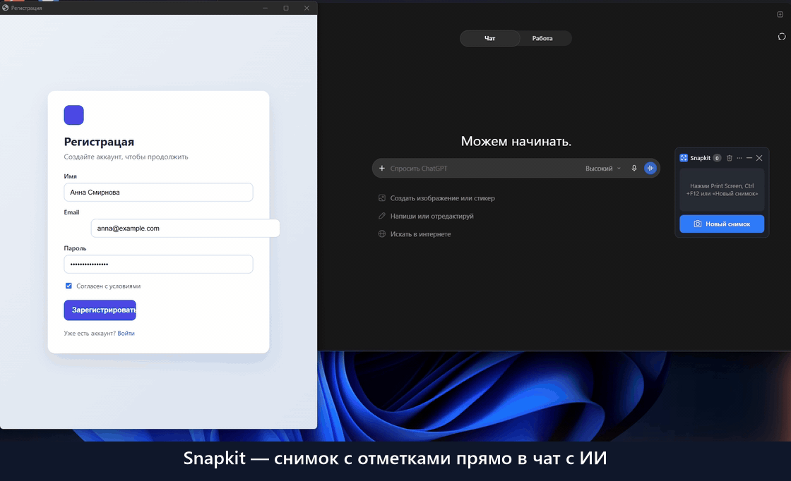

# Snapkit

Скриншотер для Windows: выделил область, обвёл и прокомментировал, нажал Ctrl+V в чате —
и все снимки с кружками A1, A2… вместе с текстом комментариев уходят в поле ввода
Claude, ChatGPT или любого другого окна. Сообщение отправляете вы сами.



Чем это удобнее обычного скриншотера:

- **ИИ понимает отметки.** На снимке — кружки A1, A2, B1, а в тексте — что под каждым из них.
  ИИ отвечает по этим пунктам, не гадая, что вы обвели.
- **Один Ctrl+V — всё сразу.** Все снимки и все подписи попадают в чат одной вставкой,
  без перетаскивания картинок по одной и перепечатывания пояснений.
- **Быстро.** Снимок → отметки → чат, без сохранения файлов и переключения между программами.

Страница с нарочными ошибками из ролика — [docs/demo/registration.html](docs/demo/registration.html).

## Установка

1. Скачайте `Snapkit.exe` со страницы [последнего релиза](https://github.com/Ozimnadius/snapkit/releases/latest).
2. Запустите его. У программы нет платной цифровой подписи, поэтому Windows может показать
   «Windows защитил ваш компьютер» — нажмите «Подробнее» → «Выполнить в любом случае».
3. Snapkit сам поставит себя в `%LOCALAPPDATA%\Programs\Snapkit`, создаст ярлык в меню «Пуск»
   и будет запускаться вместе с Windows. Скачанный файл после этого можно удалить.

Нужна Windows 10 или 11 (64-бит). Права администратора и установленный .NET не нужны.

Что менялось от версии к версии — в [CHANGELOG.md](CHANGELOG.md).

**Обновление.** Snapkit сам раз в сутки смотрит, не вышла ли новая версия, и предлагает:
«Вышла версия … — обновить?». По кнопке «Обновить» он скачивает её, сверяет хеш файла
с релизом и встаёт на место прежней; лента со снимками сохранится. Выключается это в настройках
(«Обновлять автоматически»). Можно и вручную: скачайте новый `Snapkit.exe` и запустите.

**Удаление.** «Параметры Windows → Приложения → Snapkit → Удалить» или «Настройки…» →
«Удалить Snapkit с компьютера…». Удаляются программа, ярлык, автозапуск, лента, настройки
и журнал; сохранённые снимки в папке сохранения остаются.

## Как пользоваться

- **Снимок.** Print Screen → выделите область → рисуйте. Под новой фигурой сразу открывается
  поле комментария: напишите и нажмите Enter. «Готово» (или Enter) кладёт снимок на ленту.
  Esc — отмена.
- **Инструменты редактора** (буква — клавиша, F1 или «?» — подсказка):
  - V — выбор: двигать фигуру, менять размер за маркеры, двигать кружок заметки;
  - R — фигура: прямоугольник, скруглённый прямоугольник, овал (вариант — в меню «▾»);
  - A — стрелка: прямая, изогнутая (изгиб тянется), широкая;
  - L — линия, P — карандаш, M — маркер-выделитель, T — текст;
  - E — ластик (щелчок по фигуре удаляет её);
  - B — размыть: спрятать пароль, телефон, имя — в чат уйдёт уже размытая картинка;
  - X — обрезать снимок;
  - C — комментарий: кружок с заметкой в любой точке.
  
  Цвет обводки — палитра, свои цвета, код цвета, оттенок и яркость, пипетка со снимка.
  У рамок и овала есть заливка: сплошная, полупрозрачная или размытием. В меню толщины —
  сплошная линия, пунктир или точки. Ctrl+Z / Ctrl+Y — отменить и повторить.
- **Вставка в чат.** «Готово» копирует снимок: щёлкните в поле ввода чата и нажмите Ctrl+V —
  Snapkit вставит его вместе с текстом «Снимок A / A1 — …». Чтобы вставить сразу все
  снимки ленты, нажмите на ней «Копировать всё»: Ctrl+V вставит их по очереди. Отправляете вы сами.
  После вставки снимки остаются в буфере: Ctrl+V в другом чате вставит их ещё раз.
- **Лента.** По полоске каждой карточки видно сам снимок. Щелчок по карточке открывает снимок
  на том же месте экрана — разметку можно поправить. При наведении у карточки кнопки
  «Сохранить снимок…», «Копировать снимок» и «Удалить» (удалённый можно «Вернуть»
  из уведомления).
- **Буквы.** Буква на карточке — её место на ленте, число рядом с «Snapkit» — сколько снимков
  на ленте. «Копировать всё» кладёт в буфер всю ленту по порядку; порядок
  меняется перетаскиванием карточек. Один снимок — «Копировать снимок» на его карточке.
- **Снимок файлом.** Карточку можно перетащить мышью в другое окно — Telegram, Проводник,
  форму загрузки в браузере: туда уйдёт PNG с разметкой, а следом Snapkit вставит текст
  заметок (в Telegram — подписью к фото; в папку текст не вставляется). «…» → «Сохранить всё…» кладёт
  в папку всю ленту: A.png, B.png… и `prompt.md` с текстом для ИИ.
- **Свернуть и спрятать.** «Свернуть» превращает ленту в маленькую капсулу со счётчиком
  и кнопкой снимка; «˄» разворачивает. Если лента не нужна совсем, снимите галочку
  «Показывать ленту» в меню значка у часов или в «…» — тогда после снимка появится
  короткое «Снимок скопирован — Ctrl+V вставит» — оно появляется после «Готово» всегда.
- **Лента не переполнится.** В ленте до 20 снимков; новый снимок вытесняет самый старый —
  об этом всплывает уведомление.
- **Своё копирование не мешает.** Если после снимка вы скопировали что-то своё, Ctrl+V
  вставит ваше. Чтобы вставить снимки, нажмите на ленте «Копировать всё».
- **Картинка извне.** «…» → «Вставить изображение из буфера» или «Импортировать файл…»
  добавляет на ленту картинку из другой программы или файла PNG/JPEG — её тоже можно
  разметить. Файлы можно и просто перетащить из Проводника на ленту.

## Настройки

«Настройки…» — в меню значка у часов и в «…» на ленте. Изменения применяются по «Сохранить»,
сразу, без перезапуска.

- **Общие:** запуск вместе с Windows, уведомления, «Показывать ленту», «Очищать ленту после
  вставки», «Предлагать ту же область, что в прошлый раз» (рамка сразу на месте, Enter —
  «Готово»), «Показывать курсор мыши на снимке», «Обновлять автоматически». Внизу — версия
  и «Удалить Snapkit с компьютера…».
- **Клавиши:** снимок области (по умолчанию Print Screen) и снимок всего экрана (монитор под
  мышью сразу в редакторе), у каждого до двух сочетаний. Щёлкните поле и нажмите сочетание;
  Esc — отмена, Backspace — очистить. Нужен Ctrl, Alt или Shift — кроме Print Screen и F1–F12.
- **Сохранение:** автосохранение каждого «Готово» в папку (правка снимка перезаписывает тот же
  файл), формат PNG или JPEG с качеством, папка сохранения (по умолчанию `Изображения\Snapkit`).
- **Вид:** тема — тёмная, светлая или «Как в Windows»; цвет программы — 12 вариантов, им
  красятся кнопки, рамка выделения и кружки заметок.

## Где лежат данные

| Что | Где |
|---|---|
| Программа | `%LOCALAPPDATA%\Programs\Snapkit\` |
| Снимки текущей ленты | `%LOCALAPPDATA%\Snapkit\session\` |
| Настройки | `%APPDATA%\Snapkit\settings.json` |
| Журнал | `%LOCALAPPDATA%\Snapkit\log.txt` |
| Скачанные обновления | `%LOCALAPPDATA%\Snapkit\update\` |
| Сохранённые снимки | папка сохранения, по умолчанию `Изображения\Snapkit` |

## Сборка из исходников

Нужен .NET 10 SDK (`winget install Microsoft.DotNet.SDK.10`). Собрать и поставить одной командой:

```powershell
powershell -ExecutionPolicy Bypass -File build.ps1
```

Скрипт прогоняет тесты, собирает программу, закрывает работающий Snapkit, ставит новую
версию в `%LOCALAPPDATA%\Programs\Snapkit`, создаёт ярлык в меню «Пуск» и запускает её.

Тесты, которые работают с настоящим буфером обмена (затирают его содержимое) или показывают
настоящие окна на экране, при сборке пропускаются. Запустить все тесты:

```powershell
dotnet test Snapkit.slnx
```

Один `Snapkit.exe`, как в релизе:

```powershell
dotnet publish src/Snapkit.App -c Release -p:SnapkitRelease=true -o artifacts/release
```

**Релиз.** Сначала допишите в [CHANGELOG.md](CHANGELOG.md) раздел `## [0.3.0]` — что
добавлено, изменено, исправлено. Метка вида `v0.3.0` на коммите в `main` запускает GitHub
Actions: тесты, сборка `Snapkit.exe` и публикация релиза с этим файлом; описание релиза
берётся из раздела версии. Без раздела релиз не выходит.

## Устройство

- `src/Snapkit.Core` — логика без интерфейса: модель снимков, нумерация, текст для чата,
  хранение сессии и настроек, маршрутизация клавиш. Покрыта тестами.
- `src/Snapkit.App` — приложение WPF: захват экрана, редактор, лента, перехват клавиш,
  буфер обмена, вставка и самоустановка.
- `tests/` — тесты для обеих частей.
- `tools/make-icon.ps1` — рисует значок программы.
- `docs/superpowers/` — описание проекта, планы и список приёмки.

## Лицензия

[MIT](LICENSE) — можно свободно использовать, менять и распространять с сохранением
уведомления об авторских правах.
